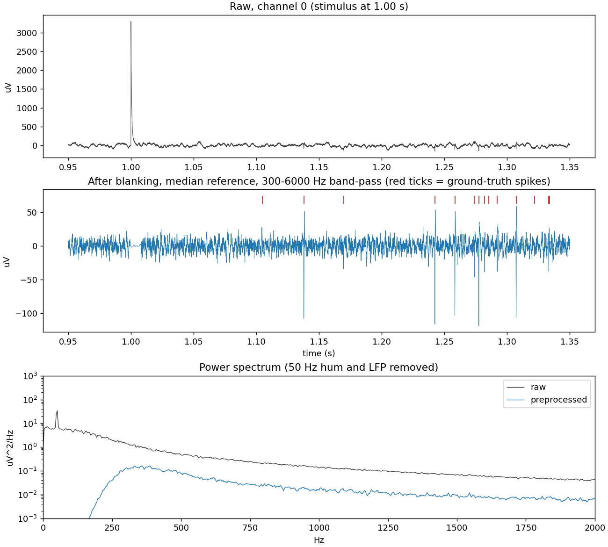

# Organoid-Pipeline (OrgPipe)

[](https://github.com/napatkitiprasanpong/Organoid-Pipeline/actions/workflows/tests.yml)

Open-source Python pipeline for analysing multi-electrode array (MEA) recordings from brain organoids:
spike detection and sorting, burst and connectivity analysis, and reservoir-style decoding.

> **Status: early work in progress.** Only the simulator and preprocessing (milestone M1) exist.
> Every other stage below is **planned, not finished**. No results on real organoid data yet.

## Why

Organoid-intelligence labs produce large MEA recordings, and spike sorting, burst/connectivity metrics and
decoding are still open problems. OrgPipe aims to be a small, reproducible, tested pipeline that is validated on
synthetic data with known ground truth first, then pointed at real recordings (for example FinalSpark's public
LiveMEA feed, which should be credited as the data source).

## Pipeline stages

| Stage | What | Status |
|---|---|---|
| 1. Simulation | Synthetic multi-channel MEA data with units, network bursts, noise, hum, stimulation artifacts, ground truth | done (M1) |
| 1b. Real data | Ingest LiveMEA HDF5 recordings through the same `Recording` interface | planned |
| 2. Preprocessing | Artifact blanking, median common reference, band-pass; SNR check | done (M1) |
| 3. Spike detection and sorting | Threshold, features, clustering, scored against ground truth; compare with SpikeInterface and np-utils | planned (M2) |
| 4. Activity analysis | Rates, ISI, bursts, network bursts, synchrony, connectivity | planned (M3) |
| 5. Decoding | Linear baseline and reservoir readout for stimulus classification | planned (M4) |
| 6. Report | One-command HTML/PDF summary per recording | planned (M6) |

## Quick start

```bash
conda env create -f environment.yml    # or: pip install -e ".[dev]"
conda activate orgpipe
pytest
python scripts/demo_m1.py              # writes docs/figures/m1_before_after.png
```

```python
from orgpipe import SimConfig, simulate_recording, preprocess, snr_change, save_recording

rec = simulate_recording(SimConfig(duration=20, stim_interval_s=4.0, seed=0))
proc = preprocess(rec)                  # blank artifacts -> median reference -> 300-6000 Hz band-pass
print(snr_change(rec, proc))            # ground-truth spike SNR before / after
save_recording(proc, "data/demo.h5")    # or .npz
```



## Design notes and limits

- The simulator is a simple generative model (biphasic spikes, rate-modulated bursts, Gaussian/LFP/hum noise,
  exponential stimulation artifacts). It tests whether a stage does what it claims; it does not model real
  organoid biophysics, drift, or real artifact shapes.
- Blanked samples are recorded in `Recording.artifact_mask`; later stages must exclude them rather than
  pretend spikes there were observed.
- The LiveMEA feed is about 4096 samples per second per electrode, probably too coarse for waveform-based
  sorting. Plan: synthetic data for sorting, live data for bursts, connectivity and decoding.
- Not for clinical use. Organoid work involves human-derived neural tissue: describe results in measured terms
  and make no claims about sentience or consciousness that the data do not support.

## Data and credits

- Synthetic data: generated by `orgpipe.simulate` from a seed, with known ground truth.
- Real data (planned, M5): recordings from FinalSpark's public LiveMEA feed. FinalSpark asks only to be credited
  as the data source; check the live viewer's terms before relying on it. Each recording will be logged in
  `data/README.md` with date, MEA ID and duration.

## Layout

```
src/orgpipe/   recording.py (container, I/O)  simulate.py  preprocess.py   [more per milestone]
tests/         ground-truth and unit tests (CI runs them on every push)
scripts/       demo_m1.py
docs/          lab-notebook.md, figures/
notebooks/     one notebook per phase (to come)
data/          notes on data sources; recordings are git-ignored
```

## Roadmap

M1 simulator + preprocessing (current) → M2 spike-sorting benchmark → M3 network analysis → M4 decoder →
M5 real-data run → M6 report and tagged release (license to be chosen before M6).
