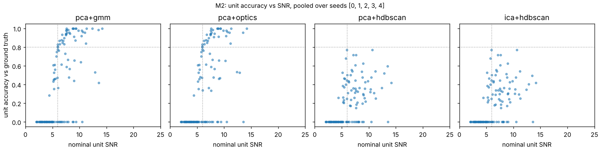

# M2: spike-sorting benchmark (synthetic data)

**Status:** own pipeline implemented and scored against ground truth. **Not yet done:** the SpikeInterface
comparison and the comparison with FinalSpark's np-utils `SpikeSorting` (see "What is not done").

## Setup

- Data: `orgpipe.simulate`, 5 seeds (0-4), 30 s at 20 kHz, 32 channels, 24 units each, stimulation every 4 s
  (blanked in preprocessing; blanked spikes are excluded from truth *and* estimate).
- All sorters get the same preprocessed recording and are scored by the same code (`orgpipe.scoring`).
- Spike match tolerance 1 ms, one-to-one. Unit accuracy = tp / (n_true + n_sorted - tp), units matched with
  the Hungarian algorithm. "SNR>=6" means nominal unit SNR (simulated amplitude on the unit's primary channel
  divided by that channel's robust noise SD after preprocessing).
- Mean ± SD over the 5 seeds. Re-run with `python scripts/run_benchmark.py`.
- Tuning was done on separate dev seeds (100, 101), never on seeds 0-4.

## Results

| sorter | units acc>=0.8 (of true) | units acc>=0.8 (of SNR>=6) | mean acc (SNR>=6) | spike recall | spike precision | sorted units | spurious/split | runtime (s) |
|---|---|---|---|---|---|---|---|---|
| detector only (no sorting) | - | - | - | 0.61 ± 0.13 | 0.98 ± 0.01 | - | - | - |
| pca+gmm | 7.6 ± 1.1 | 7.0 ± 1.4 | 0.70 ± 0.09 | 0.57 ± 0.13 | 0.99 ± 0.00 | 13.0 ± 1.4 | 2.2 ± 1.3 | 2.34 ± 0.21 |
| pca+optics | 6.8 ± 1.5 | 6.2 ± 1.5 | 0.65 ± 0.09 | 0.55 ± 0.11 | 0.99 ± 0.00 | 12.6 ± 1.3 | 2.4 ± 0.9 | 2.42 ± 0.20 |
| pca+hdbscan | 0.0 ± 0.0 | 0.0 ± 0.0 | 0.31 ± 0.06 | 0.24 ± 0.07 | 1.00 ± 0.00 | 12.4 ± 1.5 | 9.2 ± 3.3 | 1.96 ± 0.11 |
| ica+hdbscan | 0.0 ± 0.0 | 0.0 ± 0.0 | 0.31 ± 0.06 | 0.23 ± 0.05 | 1.00 ± 0.00 | 12.2 ± 1.3 | 9.4 ± 3.0 | 2.61 ± 0.31 |



## What the numbers say

1. **The detector, not the clusterer, sets the ceiling.** A 5 SD threshold finds 0.61 ± 0.13 of all spikes at
   0.98 precision. Half of all simulated units (60 of 120 across seeds) have nominal SNR below 6, and few of
   those are recovered (10 of 60 reach accuracy 0.5, only 3 reach 0.8). Sorting cannot recover spikes the
   detector never saw.
2. **Above threshold, PCA + Gaussian mixture is the best of the four here:** 35 of 60 units with SNR>=6 reach
   accuracy 0.8 (pooled over seeds). PCA + OPTICS is close behind.
3. **The main failure above threshold is units sharing an electrode.** Of the 25 SNR>=6 units that did *not* reach
   0.8, 22 share their primary electrode with another simulated unit, versus 11 of the 35 that did. Only 1 of
   the 25 had fewer than 20 spikes. The sorter clusters per peak channel, so two similar units on one electrode
   are often merged. Spike precision stays at about 0.99 throughout: the errors are misses and merges, not noise.
4. **HDBSCAN (as implemented here) performs far worse:** no unit reaches 0.8, and it leaves about 60% of the
   spikes the detector found unassigned (PCA+GMM leaves about 7%). I tried a small grid on the dev seeds (min cluster size 8/12/20, min samples 2/3/5, `eom` vs
   `leaf` selection) with no good setting, and a 4x longer (120 s) recording made it *worse*, not better, so I
   do not think this is only a shortage of events per electrode. I have not found the root cause. Treat it as
   "this configuration did not work on this simulator", not as a statement about HDBSCAN in general.
5. ICA instead of PCA made no difference to HDBSCAN here.

## Limits of this benchmark

- The simulator is simple (see README): units differ mostly in amplitude and width, there is no drift, no
  spike overlap resolution is attempted, and real units are messier. A good score here is necessary, not sufficient.
- "pca+optics", "pca+hdbscan" and "ica+hdbscan" use the same *kind* of recipe as np-utils' `SpikeSorting`
  (ICA/PCA then HDBSCAN/OPTICS) but are this repo's code with its own detector and parameters. They say nothing
  about np-utils' real performance.
- The default sorter parameters (`min_cluster_size=20`, 5 PCA components, 3 neighbour channels) were set by
  hand; only the HDBSCAN settings were explored, and only on dev seeds.
- Units need roughly 20+ spikes in a recording to be sortable at all (`min_cluster_size`).

## What is not done (M2 is not fully closed)

- **SpikeInterface sorter:** `orgpipe.sorters.sort_spikeinterface` exists and is wired into the benchmark
  (`--spikeinterface <sorter>`), but it has **never been run**: it was written where SpikeInterface could not
  be installed. Expect to adjust it for your installed version.
- **np-utils comparison:** needs np-utils cloned and its `SpikeSorting` adapted to this repo's `Recording`.
- **Cross-channel merging, overlap handling:** not implemented; the likely next gains.

To close M2:

```bash
pip install -e ".[dev,spikeinterface]"
python -c "import spikeinterface.full as si; print(si.installed_sorters())"   # pick one that is listed
python scripts/run_benchmark.py --spikeinterface <sorter>
```
